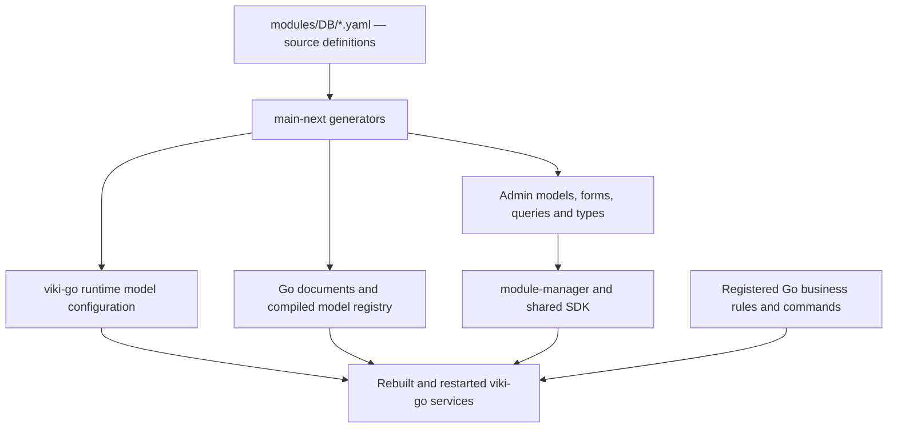

# POS backend architecture review

Reviewed on 21 October 2026. This is an investigation and a basis for the next design discussion, not an approved implementation plan or a production-readiness verdict.

The active product architecture is [revision 3.2 of the POS proposal](POS_PRODUCTION_ARCHITECTURE_PROPOSAL.md), supported by the [implementation handoff](POS_IMPLEMENTATION_PLAN.md), [operational specification](POS_OPERATIONAL_SPECIFICATION.md), [company policies and catalog](POS_COMPANY_POLICIES_AND_CATALOG.md), [researched purchasing design](POS_PURCHASING_AND_RECEIVING_DESIGN.md) and [acceptance scenarios](POS_ACCEPTANCE_SCENARIOS.md). These incorporate the user's branch-account, company-price-priority, individual-drawer, private-order, kitchen-stock and same-branch-return decisions, plus delegated operating/catalog/policy/procurement design and complete native CMP company administration. Repository findings and previously completed verification remain historical source evidence; new operating scenarios are specified, not executed. Public product/consumer-policy references in the companions do not constitute new runtime verification of these repositories.

The existing platform can provide generated models, generic data APIs, and administration screens. It already contains a substantial POS schema. For this product, customer administration is implemented in CMP; existing generated web screens are tooling/reference behavior, not the selected product frontend. The user explicitly requires a new project YAML: existing YAML files must remain unchanged and serve as design references. The implementation handoff now defines the new module's ownership, business rules and branch-authority contracts; author its YAML and implement runtime behavior the YAML cannot currently express.

## 1. Confirmed product requirements

- The product serves restaurants, cafes, clothing retailers, and supermarkets in Egypt.
- The hierarchy is Organization → Company → Branch.
- Each company owns its base catalog; branches can change their prices, but later company price revisions take priority over older branch changes. Companies within one organization may have different activities and independent company configurations, such as clothing and restaurants.
- The first release uses a shared core for restaurants, cafes, clothing and supermarkets. Their practical baseline is now defined in the operational specification under the user's delegation.
- Windows, Android, iPhone/iPad and macOS application support is required at launch, including Android/iPhone/iPad master hosting with an operating popup, automatic-screen-idle prevention and same-master recovery when reopened. Android uses an appropriate foreground service; actual lifecycle behavior needs platform qualification.
- Every branch uses a company-selected local master as its operational single source of truth, online and offline. A one-device branch runs the same local backend on that device.
- Other devices communicate with the master through P2pKit RPC. Employee accounts are independent of device identity and belong to one branch; the same person needs a separate account at another branch.
- The master may also be a cashier device, but its service role must not depend on a cashier remaining logged in.
- The master provides local login, token issuance/refresh and current permission enforcement. Administration defines roles and permissions, with editable defaults.
- Sale completion requires local persistence, not internet or central approval. Cashiers record the result of payments performed through external payment devices/services.
- The master obtains centrally managed information, including products and prices, and synchronizes branch activity with the central backend.
- Valid administrative updates apply automatically through the master. Administration selects whether eligible open orders preserve prices or are recalculated.
- The application supports planned master transfer, supervised same-device restart, and controlled emergency replacement from a verified recovery copy, including treatment of a returning old master.
- A branch may start without an independent standby and synchronize centrally. Prepare an optional standby before relying on its recovery copy; asynchronous replication never delays sale completion.
- Recover the same master automatically through supported service supervision or mobile app reopening after an unplanned interruption. Replacement requires explicit approval by a specific branch user delegated by the company, with protected local recovery access prepared for offline use. A manager role alone does not grant this authority.
- Each cashier has their own drawer/custody; counted opening, cash movements, safe transfers and immutable closing/review are defined separately from login.
- Active orders are owner-private with explicit handoff. Scoped manager/audit and kitchen/delivery projections have their own permissions.
- No sale beyond available sellable stock. Recipe ingredients are deducted on kitchen send, reversed for verified before-start cancellation and retained with correct cost/waste disposition after start.
- Same-branch returns/exchanges work offline. Customer credit sales, customer/store-credit balances, loyalty and cross-branch returns are excluded from release one.
- Support tax-inclusive/exclusive product prices, service/delivery charges, dine-in/takeaway/delivery, wrong orders/remakes and supplied-but-unpaid incidents without fictional payments or inventory restoration.
- Development should progress through generated definitions, an isolated local backend, application integration and endpoint verification, followed by deployment with the corresponding application configuration.
- Existing YAML files must not be modified. Use the accepted new `BranchPos` namespace and working `ukkera-pos` application repository, with generation isolated from current Pos/Item definitions.

Remaining deployment facts include actual peripheral models, operating load, fiscal obligations/credentials and specifically required external systems. The operating decisions are settled and delegated defaults are specified. Local/central implementation, mobile lifecycle behavior and actual device/peripheral operation still require qualification. This backend review did not re-audit P2pKit or inspect the earlier web demo; the architecture proposal separately references the P2pKit source review.

## 2. Repositories and exact revisions

The three supplied repositories depend on two additional repositories for generation and shared application behavior. These revisions describe the inspected snapshot; they are not yet a verified compatible release set.

| Repository | Revision | Actual responsibility |
| --- | --- | --- |
| [viki-go](https://github.com/ukkera/viki-go/tree/5fd67688dc91639b30567bcbec55a7158f4a9b09) | `5fd67688dc91639b30567bcbec55a7158f4a9b09` | Go/Fiber/MongoDB services, generic model APIs, authentication integration, compiled documents and hooks, synchronization |
| [module-manager](https://github.com/ukkera/module-manager/tree/e9c85dbad2d4b287fefd9c9d5fe12d709bc2333a) | `e9c85dbad2d4b287fefd9c9d5fe12d709bc2333a` | Next.js/React host for administration and application interfaces |
| [modules](https://github.com/ukkera/modules/tree/3cec39f9d2a96980d2b917fa020fddafe986233c) | `3cec39f9d2a96980d2b917fa020fddafe986233c` | Source YAML and generated frontend model/query/type artifacts |
| [main-next](https://github.com/ukkera/main-next/tree/aa0ff8f686f391283dfc27a8fa060e25f16e9fc9) | `aa0ff8f686f391283dfc27a8fa060e25f16e9fc9` | Actual YAML generators and reusable administration components |
| [common-main-r](https://github.com/ukkera/common-main-r/tree/8e3bfc6010cf621c7b3ed7fa94dce8d7da22cf9a) | `8e3bfc6010cf621c7b3ed7fa94dce8d7da22cf9a` | Shared SDK, application registry, network clients, session and offline facilities |

`module-manager` expects separate ignored checkouts named `MainApp`, `MainUtil`, and `Modules`. Checking out the manager alone does not supply the generator or SDK. See its [repository instructions](https://github.com/ukkera/module-manager/blob/e9c85dbad2d4b287fefd9c9d5fe12d709bc2333a/AGENTS.md) and [generation workflow](https://github.com/ukkera/module-manager/blob/e9c85dbad2d4b287fefd9c9d5fe12d709bc2333a/skills/model-and-module-generation.md).

## 3. What happens to the YAML

A source file has a namespace, multiple model names, and model properties and fields. One YAML file can therefore define an entire group of entities. For example, `DB/Pos.yaml` already defines 24 models.

The dialect supports scalar fields, relations, inverse relations, filters, mappings, search, ordering, shared base classes, indexes, and frontend metadata. Some modules also declare offline policies. These declarations have different consumers: frontend form validation is not proof of server-side validation, and a named YAML hook is not proof that Go executes it.

For Go, the relevant generated outputs are:

1. `configs/models/<Module>.yml`: runtime metadata, transformed names and relations.
2. `internal/document/<module>/*.go`: typed persisted documents.
3. `internal/document/main.go`: the compiled document registry, generated by a separate aggregation step.

The source YAML and runtime YAML are different formats. New writable models require generated Go documents and registry entries as well as runtime configuration. The write path [rejects unregistered models](https://github.com/ukkera/viki-go/blob/5fd67688dc91639b30567bcbec55a7158f4a9b09/internal/helpers/apis/functions/models.go#L990); updating YAML alone is insufficient. Configuration is loaded at startup, so rebuilding/restarting is part of the workflow.

The [generator entry point](https://github.com/ukkera/main-next/blob/aa0ff8f686f391283dfc27a8fa060e25f16e9fc9/script/server/index.ts#L196) also writes other backend languages. Its [output configuration](https://github.com/ukkera/main-next/blob/aa0ff8f686f391283dfc27a8fa060e25f16e9fc9/script/server/configs.ts#L1) contains developer-specific absolute paths, and its [input loader](https://github.com/ukkera/main-next/blob/aa0ff8f686f391283dfc27a8fa060e25f16e9fc9/script/server/models.ts#L16) expects lowercase `modules/DB`. Wrappers can pull repositories and overwrite generated files. An isolated, explicitly configured generation workflow is needed before running the complete scripts.

## 4. Existing domain coverage and use as design references

The definitions repository contains 54 YAML files. Strict parsing found no YAML syntax errors or duplicate mapping keys. The scan counted 738 model/base definitions, including shared and test definitions; this is not the number of production-enabled models.

| Area | Existing models | Proposed direction for discussion |
| --- | --- | --- |
| Organization hierarchy | `Org.Org`, `Org.Company`, `Org.Branch`, company users and departments | Reference existing hierarchy records where suitable; add company POS/activity profiles in the new module without changing Org YAML, allowing different company activities within one organization |
| Product catalog | `Pos.Item` and the broader `Item.Item`, attributes and variants | Model the accepted company-owned base catalog; use Item's richer shape as reference and decide exact new-model/shared-record mappings without changing the company ownership boundary |
| Branch assortment and prices | `Pos.ItemBranch`, taxes and tax groups | Derive branch availability and price changes bound to company revisions; later relevant company prices take priority; preserve historical/open-order rules |
| Inventory | Pos stock family and Item warehouse/inventory family | Establish one authoritative stock ledger for the new product; specify weighted quantities, lots, expiry and recipe consumption as required |
| Sales | `Pos.Order`, `Pos.OrderItem`, `Pos.Receipt` | Use as reference concepts; define explicit line, quantity, payment and immutable receipt contracts in the new namespace |
| Cash operations | `Pos.Shift`, `Pos.Payout` | Derive definitions with opening, cash movements, closure and reconciliation rules |
| Restaurant operation | Modifier groups, stations, kitchen tickets and tables | Useful starting entities; table changes, split bills and kitchen transitions still require business rules |
| Loyalty | Programs, accounts, transactions and upsell rules | Historical reference only; customer balances and loyalty are excluded from this product's first release |
| Finance | `Fin.Ledger`, `Fin.LedgerEntry` and other financial models | Use established monetary conventions as references; assess accounting integration separately |
| Devices | Both `Org.Terminal` and `Pos.Terminal` | Establish one device identity for this product with enrollment, master authority and synchronization state |

Sources: [Org definitions](https://github.com/ukkera/modules/blob/3cec39f9d2a96980d2b917fa020fddafe986233c/DB/Org.yaml), [Pos definitions](https://github.com/ukkera/modules/blob/3cec39f9d2a96980d2b917fa020fddafe986233c/DB/Pos.yaml), [Item definitions](https://github.com/ukkera/modules/blob/3cec39f9d2a96980d2b917fa020fddafe986233c/DB/Item.yaml), [Fin definitions](https://github.com/ukkera/modules/blob/3cec39f9d2a96980d2b917fa020fddafe986233c/DB/Fin.yaml).

The overlap must be resolved deliberately. `Pos.ItemBranch.item` references `Pos.Item`, while `item_ref` references `Item.Item`. Both inventory families exist. `Org.Shift` represents schedules, while `Pos.Shift` represents cash sessions, so their names do not make them duplicates.

Existing model families are references, not targets for editing, deleting or renaming. A new filename with the old `Pos` namespace would still generate overlapping artifacts; the new namespace is therefore significant. Whether particular fields reference shared Org/Auth/Item records or new project-owned records must be explicit. A single project YAML can contain many entities, but any references to shared modules still require those dependencies.

## 5. APIs already available

The application service mounts generic APIs under `/api/v1`. Examples below are implemented routes, not a proposed new REST convention.

| Method and path | Purpose |
| --- | --- |
| `POST /api/v1/pos/schema/` | Inspect the POS module schema |
| `POST /api/v1/pos__item/schema/` | Inspect one model |
| `POST /api/v1/multi_query/` | Query models using full names such as `pos__item` |
| `POST /api/v1/update_models/` | Bulk/cascaded model writes |
| `POST /api/v1/multi_updates_models/` | Model processing, including the existing optional sync-push envelope |
| `POST /api/v1/update_one/` | Update models through the generic API |
| `POST /api/v1/pos__item/update_one/` | Update one selected model |
| `POST /api/v1/sync/manifest/` | Discover enabled offline models and policies |
| `POST /api/v1/sync/pull/` | Pull changes for enabled models |

See [route registration](https://github.com/ukkera/viki-go/blob/5fd67688dc91639b30567bcbec55a7158f4a9b09/services/app/routes/models.go#L8). GraphQL is a separate service, exposed through `/api/graphql` in the application/gateway arrangement.

Requests go through integration-token, application, header and authentication middleware. The `App` header identifies an application record by its string ID; `App-Key` is a separate application-key mechanism. Application model grants and employee permissions are distinct.

No implemented POS sale-finalization, refund or shift-closing command was found. Those names describe operations we need to specify, not endpoints available today.

## 6. Business guarantees that need implementation work

### 6.1 Sale completion and retries

The generated schema does not implement a reliable checkout engine. Current generic cascades save records and execute side effects sequentially. No MongoDB multi-document transaction calls were found in the reviewed Go source. A request can fail after some writes have already persisted.

An authoritative sale operation needs to validate the actor and branch, accepted price/tax versions, discount permissions, quantities, payment state and stock policy, then record the sale and its required effects consistently. Returns need their own authorization and remaining-returnable-quantity checks.

The same submitted operation must return the original result when retried. Existing sync receipts are checked before execution but [written after the model processing](https://github.com/ukkera/viki-go/blob/5fd67688dc91639b30567bcbec55a7158f4a9b09/internal/helpers/apis/functions/sync.go#L204). This leaves concurrency and crash windows; a unique receipt key written afterward is insufficient to guarantee one financial effect. Financial deduplication needs durable identity, payload consistency and atomic coordination with persisted effects.

Current Go behavior is registered through compiled [hook registries](https://github.com/ukkera/viki-go/blob/5fd67688dc91639b30567bcbec55a7158f4a9b09/internal/helpers/models/functions/hooks.go#L5). No consumer of arbitrary runtime YAML `hooks` declarations or POS-specific hook registry was found. The revised product therefore needs a separate implemented local branch domain/authentication engine and verified Go ingestion/management behavior; generated YAML does not supply those guarantees.

A database transaction can protect database records. In the revised scope, payment happens externally and the cashier records its outcome. Store that attestation truthfully; optional later reconciliation is independent of sale completion. No central bank-authorization workflow is a prerequisite to checkout.

### 6.2 Organization, company and branch access

There are useful existing access mechanisms, but they do not yet establish the required POS isolation:

- [Application model enforcement](https://github.com/ukkera/viki-go/blob/5fd67688dc91639b30567bcbec55a7158f4a9b09/internal/helpers/models/permissions/app_model_access.go#L97) defaults to audit-only unless explicitly enabled. Unknown permission values currently allow access. Current KDS/kiosk domain grants also need definition.
- Early POS models use nullable organization/company filters; later ones use stricter filters and `OrgPer`. A branch relation does not enforce branch authorization.
- Multiple nullable filters emit the same `$or` key, and the [filter merge overwrites equal keys](https://github.com/ukkera/viki-go/blob/5fd67688dc91639b30567bcbec55a7158f4a9b09/internal/helpers/db/db_filters/apply_db_filter.go#L64).
- Sync pull constructs access filters and then [assigns configured/client filters over them](https://github.com/ukkera/viki-go/blob/5fd67688dc91639b30567bcbec55a7158f4a9b09/internal/helpers/sync/pull.go#L109), instead of reliably composing restrictions.
- Direct record IDs, writes, and related-record ownership need explicit negative tests. Successful scoped list queries are insufficient.

These are source findings, not live exploit results. They should be reproduced and corrected in an isolated environment before POS integration is accepted. Enabling model enforcement alone does not fix row-scoping defects.

### 6.3 Money, quantities and receipts

Current POS totals commonly use floating point, and receipt items/payments are raw JSON. `Pos.OrderItem` lacks explicit quantity and variant fields. The same gaps exist in source YAML and generated Go; they are not caused by stale generation.

Proposed direction: EGP amounts in explicitly bounded integer minor units for posted money, with defined rounding and separate precision rules for unit prices, rates and weighted quantities. `Fin.LedgerEntry.amount_minor` is an existing pattern. Current integer inventory quantities require either a scaled-unit convention or a compatible quantity representation.

A finalized line needs a durable snapshot of the sold product/variant, modifiers, quantity/unit, price, discounts and taxes so later catalog changes cannot rewrite historical receipts. Typed fields or a validated, versioned snapshot document can implement this; unvalidated raw data cannot enforce it.

Egyptian tax requirements and electronic invoice/e-receipt integration need explicit scoping. No completed ETA workflow was established by this review, and `DB/Invoice.yaml` is empty.

## 7. Mapping the platform to branch-master operation

The existing offline infrastructure is a starting point, not the requested branch-master system.

The backend has manifest/pull and mutation push support, with model policies such as full/own and conflict rules. However, Pos currently declares no offline policy. The shared SDK has native/Node SQLite adapters and per-item outbox processing; browser IndexedDB support is not established by the reviewed implementation.

Local SQLite atomic writes do not prove atomic cloud processing. Neither layer currently establishes a company-selected RPC master, a master replacement protocol, or a complete POS command engine.

The current user-approved responsibility contract is:

| Concern | Responsibility |
| --- | --- |
| Management changes | Administration authors them; the master validates and activates the effective local revision |
| Local login and permissions | Master-owned accounts, sessions and current permission checks; users can change devices |
| Sale approval | Local master command, with no internet dependency |
| External payments | Cashier-recorded outcome, preserved as an attestation |
| Cashier communication | Authenticated RPC to the master, or a protected same-device adapter |
| Branch operational state | Master-authoritative records, synchronized centrally |
| Central reporting | Reads synchronized branch operations and their freshness |

The schema and protocol need the assigned master, authority generation, trusted device identity, independent user/session identity, role permissions, operation IDs, local durable outbox/inbox and synchronization acknowledgement. These concepts can span multiple models; the new YAML has not yet been authored.

One device still runs the local master. Internet loss does not switch authority, invalidate a cloud lease or force cloud login renewal. When the master is replaced, the old device must be retired safely and complete recovery state verified; replacement is distinct from ordinary offline operation.

For a master-approved sale, central synchronization must recognize the same committed operation and deduplicate it, rather than execute it as a second checkout. Reconciliation should preserve the recorded price and tax snapshot and expose exceptions explicitly. The local master must implement the agreed business contract too; central Go code alone cannot validate a sale while the branch is offline.

P2pKit supplies the proposed communication layer. Persistence, authorization, operation semantics, authority fencing and recovery still belong to the application design.

## 8. Verification actually completed

Three investigation agents reviewed the runtime, module manager/SDK, and model definitions, with an additional parent review of the generator and cross-repository results.

| Check | Result and limit |
| --- | --- |
| Strict YAML parse | 54 files parsed without syntax errors or duplicate mapping keys |
| POS source/runtime/Go agreement | Same 24 models, matching checked schema attributes and stored fields after inverse/base normalization |
| Isolated execution of existing generator functions | Pos 24, Org 8, Item 14, Fin 20: 66 runtime definitions and 66 Go source files generated |
| Generated runtime comparison | No differences in checked field-name sets, types, relation targets, inverse mappings and groups against committed runtime files |
| Shared SDK import targets | Three missing Pos targets: AutopilotSignal, AutopilotAction, AutopilotEvidence |
| Repository integrity | No tracked source changes in the five reviewed repositories |

The generator exercise used the existing exported transformation functions in a temporary workspace. It did not run the broad wrappers, registry aggregation, Go formatting/compilation, services, database operations or deployment. Its machine-readable result is in [generator-verification.json](backend-review/generator-verification.json).

The [three SDK exports](https://github.com/ukkera/common-main-r/blob/8e3bfc6010cf621c7b3ed7fa94dce8d7da22cf9a/Modules/Apps/PosManager/index.ts#L43) have no matching reviewed source or generated model files. No frontend build was run, so this is a confirmed missing-target finding, not a claimed observed compiler failure. A compatible repository set or a deliberate repair is needed before application validation.

No local endpoints were exercised. Go was not available in the inspected environment, and the installed Docker client could not reach a running engine. No live application or business database was accessed.

## 9. Concrete local workflow after the schema discussion

1. Pin a compatible revision set and make the generator paths explicit. Resolve stale SDK exports without inventing business models merely to satisfy imports.
2. Agree the new namespace, project-owned entities and shared references, then author the new project YAML using current definitions as reference material. Leave existing YAML files and their model meanings unchanged.
3. Generate the new namespace's runtime configuration, Go documents and required administration/query/type artifacts, and update aggregate registration as needed. Review generated diffs to ensure existing module artifacts are not unexpectedly rewritten; build the affected services and clients.
4. Start isolated central MongoDB and required app/auth services for management and synchronization tests. Use a local replica set for the required central transactions. Separately start the branch runtime and its local database/authentication service.
5. Seed only local application records, roles, organization/company/branch, devices and catalog data. Establish usable local employee credentials and test their independent sessions.
6. Exercise generation/CRUD and the custom master and ingestion paths. Stop central services and prove that local login, token renewal, checkout and normal master recovery still work.
7. Connect native branch clients to the master through RPC or a protected same-device adapter. Configure central REST/auth/GraphQL only for the management/sync paths that actually use them. The shared GraphQL client expects an origin and appends its path; do not accidentally retain remote defaults.
8. Deploy matching generated artifacts, ingestion/administration handlers, grants, indexes and schema versions before switching the central environment settings. Branch clients continue to execute against their local master.

The Go module requests Go 1.24.0/toolchain 1.24.4; older README instructions are stale. A fresh local `.env` file is required by the current loader even if variables are exported. Broad startup helpers can start multiple services and seed data, so they should not be used with inherited remote configuration.

Minimum meaningful acceptance cases:

- A scoped cashier can complete a valid sale; unauthorized discounts/refunds are denied.
- Another organization/company/branch cannot read, update or reference its records, including direct-ID and sync requests.
- Two companies with different activities under one organization have independent catalogs, profiles and scoped permissions; a branch price change does not edit the company base or another branch's price.
- Retrying after a lost response returns the same sale and does not repeat cash, stock, payment or kitchen-issue effects.
- Concurrent sale attempts and failures during persistence follow the agreed stock and consistency rules.
- Partial returns cannot exceed original quantities or refundable amounts.
- A client retries an RPC without creating a second operation; a master restarts and recovers pending synchronization.
- The old master cannot create competing accepted operations after a permitted authority change.
- Central synchronization preserves the branch operation identity and historical pricing.
- Switching users on one device clears private session state and preserves the original actor on unresolved operations.
- Cashier-confirmed external payments complete locally with central services unavailable.
- Cash and cashier-confirmed external payments complete and print while the standby is also unavailable; the durable replication backlog catches up without repeating business effects.
- Same-master recovery is automatic where supported; replacement never happens automatically and requires individual company delegation, verified recovery data and retirement of the old authority.
- Administrative packages activate automatically and follow the selected open-order price policy.

## 10. Decisions needed before the first project YAML

The [decisions review](POS_OPEN_DECISIONS_REVIEW.md) now records the answered business questions, the defaults supplied under the user's delegation and remaining deployment facts. The operational specification supplies the first-release feature matrix, candidate entity groups and guarded command families.

Before generating the first project YAML, finish the field/ownership/relationship map and exact new-namespace/shared-record references. Preserve branch-local account identity, company price revisions, cashier custody, owner-private orders, kitchen issue/reversal/waste, local return entitlement and exchange/incident documents. Excluded credit/balance/loyalty workflows must not be enabled by importing the old POS schema wholesale.

Engineering work still includes exact representations/indexes, command and synchronization contracts, protected write paths, recovery coverage and migration/version handling. Actual peripheral models, launch workload and Egyptian fiscal requirements/credentials must be established for deployment qualification. These are not reasons to reopen the settled business decisions.

Then author the new YAML in isolation and verify the generated definitions together with implemented local and central business paths. The previous generator exercise remains a narrow source transformation check, not acceptance evidence for the operational specification.

## 11. Repository skills reviewed

At the user's request, the repository skill directories were checked explicitly. Relevant instructions are under `viki-go/skills` and `module-manager/skills`; no equivalent skill directory was found in the reviewed modules, main-next or common-main-r checkouts. Some other filenames containing “Skill” describe employee business models and are not agent instructions.

| Skill | How it applies to this project |
| --- | --- |
| [Model and module generation](https://github.com/ukkera/module-manager/blob/e9c85dbad2d4b287fefd9c9d5fe12d709bc2333a/skills/model-and-module-generation.md) | Source YAML ownership, backend versus frontend generation, the separate registry aggregation step, relation syntax, menus and generator output paths |
| [DB models](https://github.com/ukkera/viki-go/blob/5fd67688dc91639b30567bcbec55a7158f4a9b09/skills/db.md) | Backend generation workflow and keeping hand-written helpers outside generator-owned model files |
| [Application service](https://github.com/ukkera/viki-go/blob/5fd67688dc91639b30567bcbec55a7158f4a9b09/skills/app.md) | Generic API, application/authentication context and sync facilities; reviewed in the initial investigation |
| [Local verification](https://github.com/ukkera/viki-go/blob/5fd67688dc91639b30567bcbec55a7158f4a9b09/skills/local-verification.md) | Disposable local database, real registration/login, explicit application-registry seeding and verification outside development mode |
| [Shared SDK boundaries](https://github.com/ukkera/module-manager/blob/e9c85dbad2d4b287fefd9c9d5fe12d709bc2333a/skills/mainutil-cross-platform.md) | MainUtil is shared with React Native; preserve platform compatibility and keep server-only dependencies out of shared code if SDK changes become necessary |
| [Seed data scripts](https://github.com/ukkera/module-manager/blob/e9c85dbad2d4b287fefd9c9d5fe12d709bc2333a/skills/seed-data-scripts.md) | Data seeding and schema generation are separate operations; use explicit local configuration for any future demo-data run |
| [Lint and type checks](https://github.com/ukkera/module-manager/blob/e9c85dbad2d4b287fefd9c9d5fe12d709bc2333a/skills/lint-and-typecheck.md) | Required validation after implementation changes in that repository |
| [Frontend component catalog](https://github.com/ukkera/module-manager/blob/e9c85dbad2d4b287fefd9c9d5fe12d709bc2333a/skills/components/README.md) | Describes metadata-driven forms, tables and actions; use existing registries if the project later uses this admin frontend. This does not decide the POS client technology |

The local-verification skill's runnable examples concern HR and support, not POS. Their existing results are not POS acceptance evidence. The useful pattern is an isolated database, real authentication and waiting for the required seed initialization before sending test requests.

The generation and DB skills describe a runtime-config-only shortcut for exposing GraphQL models. That is narrower than supporting the POS write path, which checks the compiled Go document registry. For this project, preserve the source-YAML → generated configuration/documents/registry workflow already established in this review.

The user's instruction remains controlling: create a new project YAML and leave existing YAML unchanged. Reading these skills did not run generators, seed databases, start services or modify the reviewed repositories.
