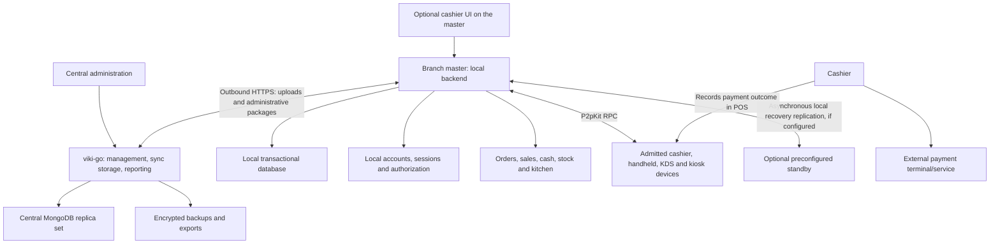

# POS production architecture — revised branch-authoritative design

Revision 3.2, 21 October 2026. Adds the user's final execution choices: all company administration inside Compose Multiplatform, repository `ukkera-pos`, namespace `BranchPos`, current compatible libraries, multi-agent implementation/review and complete verification. Read the [implementation handoff](POS_IMPLEMENTATION_PLAN.md) with the [operational specification](POS_OPERATIONAL_SPECIFICATION.md), [company policies and catalog](POS_COMPANY_POLICIES_AND_CATALOG.md), [researched purchasing design](POS_PURCHASING_AND_RECEIVING_DESIGN.md) and [acceptance scenarios](POS_ACCEPTANCE_SCENARIOS.md). Retains the accepted platforms, local master, offline payment recording and approved recovery architecture. This is a design specification, not a claim that a production system has been built or qualified.

Existing YAML files remain unchanged. Implement a new `BranchPos` project YAML from the accompanying domain/contract blueprint and generator validation; no further namespace decision is required.

## 1. Accepted requirements

1. Every branch has one active master, whether the branch has one device or many. The master is the single source of truth for branch operation both online and offline.
2. A master may also run a cashier UI. Its backend runtime is independent of the currently logged-in cashier.
3. Other devices connect to the master through P2pKit RPC. Device admission and human login are separate.
4. Users have independent accounts and authenticate against the master's local backend. They receive tokens and can use different admitted devices without changing their identity or inheriting another user's session.
5. Administration defines roles/types and permissions. The master stores and enforces them. Login returns effective permissions for the UI. Ordinary roles also have editable default templates.
6. Completing a sale does not require internet, a central-server response, a bank API response, a cloud login refresh or a cloud master lease.
7. Electronic payment happens on an external device or service. The cashier records whether payment was completed and the amount/method. The POS does not initiate or independently verify that external payment in this scope.
8. The master uploads its data when internet is available and receives administrative changes. Valid incoming changes activate automatically under the defined policies.
9. Administration chooses whether eligible open orders preserve existing prices or are recalculated after price updates.
10. The target remains Egypt, supporting restaurants, cafes, clothing retailers and supermarkets under Organization → Company → Branch.
11. Support transferring the master role to another approved device and handling master UI closure, service crashes, shutdown and device loss, while preserving one active authority and the original ownership of financial operations.
12. A branch may start with one master and central synchronization without an independent local standby. If a standby is configured, prepare it and its recovery access before an incident; it remains non-authoritative until approved transfer or recovery.
13. Confirm a sale after its durable master commit even if the standby is unavailable. Replication to the standby and synchronization to central services run asynchronously.
14. Automatically attempt to restart the same master after an unplanned crash where the OS permits supervised restart. A mobile app automatically recovers its existing master role when reopened, subject to persisted role/stop/handover checks. Replacing the master requires explicit human approval; health checks never promote the standby automatically.
15. The company delegates transfer and recovery to specific users within the branch. A generic manager role alone does not grant this authority. Provision the delegation and protected recovery access locally so authorized replacement can work without internet.
16. Windows, Android, iPhone/iPad and macOS are required application platforms from the first release, with Android and iPhone/iPad allowed to host the master too. A mobile master shows a popup explaining that the app must remain open, prevents automatic screen idle while actively hosting, and recovers the same master automatically when the app is reopened. Android uses an appropriate foreground service for background continuity; iOS hosting relies on the app remaining active. OS termination, suspension and manual device locking remain real lifecycle events.
17. Each company owns its base catalog. Branches can change their prices under permissions. One organization can contain companies with different activities, such as a clothing company and a restaurant company, each with independent company configuration and data scope.
18. The first release uses a shared core serving restaurants, cafes, clothing and supermarkets. The user delegated selection of a practical baseline for all activities; it is defined in the operational specification.
19. Company price updates take priority over branch price changes. Apply the versioned company-priority rule in section 3.1 while preserving the separately configured open-order policy and historical receipts.
20. Employee accounts belong to one branch. The same person needs a separate account for another branch; accounts remain independent of admitted devices within their own branch.
21. Each cashier has their own drawer assignment. Implement counted opening, explicit cash custody/movements, closing reconciliation and review as detailed in the operational specification.
22. Active/parked orders are accessible to their owner, with explicit handoff to another employee. Manager/audit and operational service projections require their own permissions.
23. No selling beyond available sellable stock. Deduct recipe ingredients when sending quantities to the kitchen; restore only quantities verified cancelled before preparation starts. After-start cancellation retains the deduction and records the correct waste/cost disposition.
24. Handle wrong orders, remakes, substitutions, partial preparation, unpaid fulfillment, partial collection, cancellations, refunds and exchanges through explicit linked states and documents.
25. Returns and exchanges are restricted to the selling branch in release one and work without internet. Customer credit sales, customer/store-credit balances and loyalty are excluded from release one.
26. Support product prices marked tax-inclusive or tax-exclusive, including mixed orders, service/delivery charges, dine-in, takeaway and delivery. Applicable Egyptian fiscal integrations still require the launch businesses' actual requirements and verification.
27. The company head controls company permission limits, named delegations, report/cost visibility, exports and alert recipients. Defaults are configurable; the master enforces the activated policy offline without making a role template an unrestricted bypass.
28. The user delegates practical price/promotion and return-policy defaults. Preserve company price priority and original receipt allocations; apply category-specific customer-remedy rules and keep same-branch offline redemption.
29. Cover the agreed activities with composable products: variants, units/packs, weights, lots/expiry, serials, ingredients, recipes, finished batches, kits/combos, services and optional receipt-linked packaging deposits. Do not imply excluded stored-value or specialized industry systems.
30. Provide simple receiving and full purchasing workflows, with stock receipt, supplier invoice, actual settlement and supplier return/credit as distinct linked effects. The receiving master remains authoritative; generic central writes cannot change its stock.
31. Provide the approved resumable branch setup wizard and practical Arabic/English touch, keyboard and scanner workflows, including visible uncertain outcomes and operation recovery.
32. All company administration is inside the Compose Multiplatform app. Reuse viki-go and the existing generation infrastructure; module-manager is not the customer-facing administration frontend for this product.
33. Use `ukkera-pos` and `BranchPos` as the accepted working repository/namespace. Use the latest verified compatible Navigation 3, Koin, Coil, Room and supporting toolchain with explicit prerelease/qualification handling for requested P2pKit.
34. Implement through bounded concurrent agent tasks, independent reviews and main-agent integration. Verify business, error/boundary, security, concurrency, recovery, performance and real supported-platform behavior; hardware/load assumptions remain provisional until measured.

Ordinary offline operation requires a healthy master, reachable local network for remote clients, working local storage and an enabled local account. Internet unavailability alone must not invalidate those conditions.

Platform implementation and qualification remain engineering work. The operational specification supplies the cash/shift/order/activity defaults the user asked the assistant to design; they are reviewable company settings where appropriate. User-selected authority, branch account scope, price priority, stock behavior, ownership, return scope and first-release exclusions are fixed requirements.

The [decisions and remaining facts review](POS_OPEN_DECISIONS_REVIEW.md) records resolved choices, delegated defaults and the remaining deployment facts. Do not reopen the answered one-device, account, price, stock or return questions.

## 2. Overall system

The external payment terminal/service has its own connectivity and processing. There is no POS-to-provider verification dependency in checkout.

The master opens outbound central connections. Branch clients obtain their operational data, sessions and command results from the master. Central availability does not select a different execution path.

## 3. Responsibility boundaries

| Concern | Branch master | Central system | Client |
| --- | --- | --- | --- |
| Effective branch configuration | Validates and activates it; owns the active local version | Administration authors and distributes intended changes | Displays allowed effective settings |
| User login and refresh | Verifies local credentials; issues and revokes local sessions | Manages directory/policy changes for synchronization | Holds its current session securely |
| Authorization | Enforces current local policy on every relevant request | Authors policy and receives application status | Uses returned permissions to shape the UI |
| Orders, sales, cash and branch stock | Sole operational writer | Durable synchronized copy, reports and administrative requests | Submits commands and displays results |
| External payment outcome | Records cashier attestation and applies local payment policy | Receives recorded outcomes; optional later reconciliation | Cashier enters the outcome and reference |
| Device admission | Pairs/adopts devices under local administrator authority | Maintains management inventory and assignment history | Maintains a protected device identity |
| Master assignment | Enforces the current appointment and controlled retirement | Company manages intended assignments and recovery delegation | Connects only to the explicitly trusted current master |
| Recovery | Maintains journal, outboxes and recovery checkpoints | Stores independent backups and synchronized copies | Retains its unresolved command identities |

Central management intent becomes effective for a branch when its master validates and activates it. Show “pending delivery,” “applied” or an explicit exception centrally. A cloud write does not silently change an offline branch.

There is no Central Direct checkout mode in this revision. With one physical device, the same local backend and cashier UI run on that device. With multiple devices, remote clients use RPC.

### 3.1 Companies, activities and catalog ownership

One organization can contain a clothing company and a restaurant company simultaneously. Each company has its own catalog and activity configuration; branches belong to their company and use that company's catalog. Activity configuration belongs in the company's POS profile, rather than a single organization-wide activity that would force all companies to behave identically.

| Level | Owned configuration and data |
| --- | --- |
| Organization | Company directory and explicitly authorized consolidated administration/reporting |
| Company | Base catalog, products/variants, base price definitions and company POS/activity policies |
| Branch | Catalog assortment, branch price changes, effective local configuration and branch operational records under its master |

Use one shared product model and command core with activity-specific capabilities and validation. Company/activity profiles select the applicable workflows and UI. The common implementation does not make company catalogs, stock, drawers, customer balances or employee permissions automatically shared. Cross-company access requires explicit grants and scope checks on reads, writes, references, synchronization and caches.

An illustrative organization could contain Clothing Company → Downtown/City Mall branches and Restaurant Company → Central/West branches. A price change at the clothing Downtown branch affects that branch's effective price; it does not edit the City Mall price or the restaurant catalog.

Represent a branch price change separately from the company base price, with company/branch/product or variant identity, relevant price-list context, revision, actor and effective time. The master remains responsible for activating the branch's effective price and applying the agreed open-order policy. Preserve the actual sold price in immutable sale snapshots.

Company-priority rule: bind a branch change to the current company revision for that specific product/variant and price context. A newer company price revision supersedes branch changes based on an older revision when activated by the master. Example: company 100, branch 120, then a company release of 150 yields effective price 150. A stale offline branch change cannot overwrite that newer company price during synchronization. Preserve all superseded changes for audit.

An authorized branch can make a new change against the now-current company revision while company policy permits branch price editing. Unrelated catalog changes do not invalidate every branch price. The open-order policy still determines which existing orders retain their price snapshots; company priority does not rewrite paid or protected customer-committed totals. The operational specification defines this rule in detail.

Add company POS configuration in the new namespace through references to the existing company identity. Existing Org/Pos/Item YAML files remain unchanged. Whether an individual field is embedded or a separate model remains an implementation choice.

## 4. Technology and deployment proposal

Use the existing viki-go system for central management, ingestion, reporting and applicable asynchronous integrations. Build all company administration inside the same Compose Multiplatform application. Keep module-manager/main-next/modules as applicable generator and platform tooling references; do not require their generated web UI as the product's administration frontend.

Native central administration authenticates to central management APIs with a scoped central principal. Branch operation authenticates to its master with the employee's separate branch-local account. Separate sessions, tokens, repositories, caches and navigation roots; a central company-head session does not gain direct branch checkout authority. Offline global administrative edits remain clearly marked drafts/pending until central acceptance and branch activation, while delegated local branch changes retain their existing offline authority.

For the branch, propose a Kotlin/KMP domain, client and portable local-backend core, with platform adapters for hosting, storage, networking and protected credentials. Use Kotlin/JVM for desktop hosting, Android-compatible service hosting, and a Kotlin/Native-compatible in-app runtime for iPhone/iPad. Use transactional SQLite through a supported database layer on each platform. Kotlin/JVM alone cannot host an iOS process. The YAML generator continues to produce central definitions; the portable local backend still requires implementation.

| Platform | Application requirement | Master/standby design status |
| --- | --- | --- |
| Windows | Required at launch | Qualify a supervised desktop runtime, networking, storage and peripherals |
| macOS | Required at launch | Qualify a supervised desktop runtime, networking, storage and peripherals |
| Android | Required at launch | Master hosting required: operating notice, keep-screen-on behavior, appropriate foreground service and same-master recovery when reopened; qualify OEM/power/service restrictions |
| iPhone/iPad | Required at launch | Master hosting required while the app is active: operating notice, disabled automatic screen idle and same-master recovery when reopened; suspension/termination interrupts hosting |

This table records product targets and outstanding qualification, not implemented support or permission to drop a requested platform. The company selects the master from the ultimately supported role profiles.

The current P2pKit RPC targets are Android, JVM and iOS; the reviewed module does not provide a browser JavaScript/WASM target. A browser cashier would require an explicit native bridge or different local transport decision. The existing web demo does not determine the production client technology.

Browser cashier support was not explicitly included in the user's platform answer and remains unconfirmed. It is not a prerequisite for progressing the four named application platforms.

A dedicated master or a cashier machine can host the same runtime. The company selects the device from supported deployment profiles. A modern 64-bit machine, SSD, wired LAN, UPS and an initial 8 GB RAM profile are starting points for qualification, not demonstrated performance guarantees.

Android foreground-service continuity is subject to OS, OEM, permission and force-stop behavior; it is not an unconditional keep-alive mechanism. iPhone/iPad use the accepted active-app hosting policy. Current published P2pKit candidates retain platform qualification limits; verify the actual shipped OS, runtime, native providers and network topology.

Use OS supervision for desktop hosting and the platform lifecycle described below for mobile hosting. Prevent two writable instances from opening the same branch database. A separate desktop cashier UI process uses authenticated OS-local IPC to the same backend; restricted P2pKit RPC does not accept loopback endpoints. Mobile in-process or service adapters reach the same authorization and domain service. Local backend identity is independent of the logged-in cashier even where the UI and runtime share one mobile process.

Cashier logout, UI navigation and ordinary token expiry do not stop the master runtime.

### 4.1 Mobile master operating contract

When an Android or iPhone/iPad device is appointed or activated as master, display the requested popup explaining that the application must remain open and the screen active for reliable branch service. Keep the master role and runtime health visible. The notice is operational guidance, not a new cloud approval or a reason to require another manager assignment after each restart.

While actively hosting in the foreground, request the platform's supported automatic-screen-idle prevention. On Android, use the appropriate foreground-service lifecycle and notification for background work; on iOS, prevent idle screen locking while the app is active. Scope screen-awake behavior to the hosting role and release it when that role is stopped or retired. Do not force the device to stay awake merely because it is an ordinary client.

Preventing idle screen locking does not prevent manual locking, switching apps, OS suspension, force-stop, process termination or power loss. A popup cannot override these conditions. Show disconnected/recovering states on clients when the master becomes unavailable, preserve unresolved operations and retain the approved manual-replacement policy.

On app launch, read the durable branch identity, master assignment, intentional-stop marker, retirement/handover state and database recovery status before admitting writes. If this is still the active master and no stop/recovery restriction applies, start its local backend automatically with the same device identity and epoch, restore pending work, re-enable the operating screen policy and accept trusted client reconnections. Resume without internet or requiring a cashier to log in merely to run the backend. Human sessions remain subject to local authentication policy.

Automatic recovery on reopening does not mean that iOS or Android will automatically reopen a terminated app. Supported Android supervision may restart the service when allowed; otherwise reopening the app supplies the recovery trigger. A returning device that was replaced must still follow the old-master retirement/isolation rules in section 18.

Mobile standby replication follows the same real OS availability limits. Track verified copy progress and freshness; a suspended standby is not shown as up to date merely because it was prepared previously. Standby unavailability still does not gate sale confirmation on a healthy master.

## 5. Device connection and employee identity

A device identity proves which admitted application/device opened the encrypted connection. It does not identify the current employee.

Device records contain identity, branch membership, status, display name, supported peripherals and connection history. A display profile such as “cashier screen” or “kitchen screen” is not a grant of human financial permissions.

A user has a stable branch-local account ID, local login identifier, profile, active status and role assignments. That ID does not change when the user changes admitted devices within the branch. Working in another branch requires a separate account and local credentials/permissions; an optional shared staff-directory reference grants no cross-branch login or access.

A session represents one login. It references the user and branch, and may record its originating device for audit and theft/replay controls. This association is not permanent account-to-device binding and must never prevent an authorized user from signing in on another admitted device.

Every business record captures the actual user from the authenticated session. Do not derive the cashier from the terminal's owner or accept a caller-supplied cashier ID as identity proof.

Before login, a paired device may access only the minimal authentication/bootstrap procedures allowed by policy. Pairing alone must not expose branch sales, customer details or financial commands.

For unattended screens, use an explicitly scoped service account/session. A KDS account can read assigned kitchen work and update allowed ticket states. A kiosk can create an order under policy; customer input cannot attest that an external payment was received.

## 6. Local account provisioning and authentication

Initial deployment can obtain the branch structure, employee profiles and policies from central management. Authorized local administrators can provision or disable accounts and perform recovery locally within their delegated permissions, including during an outage.

Do not confuse employee directory synchronization with possession of a usable local login credential. Each enabled local account needs an established credential verifier or local activation process.

Recommended credential workflow:

1. Administration creates the employee's account for exactly one branch and assigns its local roles. A different branch needs a different account, even for the same human employee.
2. The master receives the profile, or a delegated local administrator creates it locally for later synchronization.
3. A local activation/reset workflow establishes the branch login credential. Never synchronize plaintext passwords or PINs.
4. Store a salted, appropriately expensive credential verifier using a qualified implementation, with persistent rate limits and lockout/recovery policy.
5. Central reset requests arrive as authenticated administrative commands and are applied by the master. They are not a reason to call the cloud during every login.

Do not assume the existing cloud Auth endpoint automatically provides offline credential verification. A cloud account may be linked to the branch profile, but the branch login mechanism needs its own implemented contract.

Proposed local RPC procedures:

| Procedure | Responsibility |
| --- | --- |
| auth.login | Verify local credentials and issue a session |
| auth.refresh | Renew a local session without internet |
| auth.logout | Revoke the current session locally |
| auth.me | Return user, roles, current permissions and policy version |
| auth.revokeSession | Authorized session termination |
| auth.activate / auth.resetCredential | Controlled local account lifecycle |
| auth.approveAction | Issue narrowly scoped, audited manager approval if enabled |

All authentication traffic uses the encrypted P2pKit connection or the protected same-device adapter. Credential fields and tokens are excluded from logs and diagnostics.

## 7. Tokens and permission enforcement

Propose opaque, cryptographically random access and refresh tokens backed by a local session registry. The server stores token hashes; the client stores active secrets in protected application storage. A signed-token design is possible, but does not remove the need for current session and permission checks.

Illustrative defaults are a 15-minute access token and a renewable work-session lifetime controlled by administration. Both renewal and re-login run on the master. These values are not cloud connectivity deadlines.

Login returns:

- Session identifier and access/refresh tokens.
- Stable user ID and a display-safe profile.
- Branch context.
- Assigned roles and effective permissions.
- Numeric/action limits and current permission-policy revision.
- Expiry information for the local session.
- Any required credential-change or work-session state.

The client uses this to show actions. The master checks its own current policy on every protected operation and protected read. A permission list sent back by the client is never evidence of authorization.

Check user activity, session revocation, branch scope, role policy, resource ownership/visibility, business state and any required approval. A paired device cannot bypass a failed user check.

Role changes and user disablement take effect locally as soon as the master applies them. Notifications ask clients to refresh their UI, but lost notifications do not preserve revoked server-side rights. A previously authorized operation already committed remains attributed and audited; new unauthorized work is denied.

Rotate refresh tokens transactionally and serialize client refresh. Handle lost refresh replies without accidentally issuing multiple independent sessions; any unrecoverable refresh can fall back to local re-login. No central request is required.

## 8. Switching users without data leakage or misattribution

Default: one active interactive user per client UI and one active interactive session per branch account, with an explicit move-to-another-device workflow. Administration may permit additional sessions within the branch. This is a session policy, not hardware ownership or permission to reuse the account in another branch.

When user A logs out and user B logs in on the same device:

1. Revoke A's session at the master when reachable; clear local authentication immediately.
2. Cancel A's private subscriptions and UI work, and increment a local session generation.
3. Ignore late responses and events from A's previous generation.
4. Remove A's tokens, permission snapshot, private displayed data and private transient cart state from the active UI.
5. Keep shared branch catalog caches only in correctly scoped shared storage.
6. Preserve unresolved financial commands in a protected recovery journal attributed to A; do not delete evidence merely to clear the screen.
7. Authenticate B locally and load B's permissions, private workspace and permitted branch data.
8. Never resend A's unresolved sale as a new sale or relabel it using B's token.

If logout occurs while disconnected, close the local user session immediately and retain any necessary revocation/recovery intent. The remote session may remain valid until revocation reaches the master or its local token expires; describe that state truthfully.

Active and parked orders are owner-private. Ordinary cashiers cannot browse or edit each other's orders; an explicit accepted handoff changes ownership. Manager/audit access, kitchen/delivery task projections and narrowly scoped historical receipt lookup for returns have separate permissions. None of these grants follow merely from using another employee's device.

Handoff preserves the original creator and every previous actor. Serialize handoff with edits and collection locks; an unresolved payment cannot be reassigned as though a new employee collected it. A manager may perform audited reassignment if the owner is absent, following the operational specification.

## 9. Administration-defined roles with useful defaults

Use editable role templates, company-head-controlled policies and bounded delegated branch adjustments. Organization-level administration is explicitly scoped and does not automatically grant company financial access. Defaults create a starting configuration; they do not override later administrator decisions when software updates. The [company policy specification](POS_COMPANY_POLICIES_AND_CATALOG.md) defines action/approval limits, named self-approval where explicitly needed, report/field/export scope and alert access.

| Default role | Starting capabilities |
| --- | --- |
| Company administrator | Manage structure, role templates, branch policy, master/recovery delegation and consolidated reports |
| Branch manager | Manage permitted local operation, approve discounts/returns, review cash variance and perform delegated account/device actions |
| Cashier | Create/edit allowed orders, record cash/external tenders, finalize sales, view allowed receipts and operate an assigned cash session |
| Waiter | Manage permitted orders/tables and send items to kitchen; no default payment finalization or cash adjustment |
| Kitchen operator | Read assigned tickets and perform permitted preparation transitions |
| Inventory operator | Receive/dispatch/count stock within policy; exceptional adjustments require the configured approval |
| Accountant/auditor | Read permitted financial reports, reconciliations and audit records; no direct rewriting of posted sales |
| Kiosk/KDS service account | Only the narrow procedures required by that unattended UI |

Suggested granular permissions include order.create, order.edit, sale.finalize, payment.record_external, receipt.reprint, refund.create, discount.override, cash.open, cash.move, cash.close, stock.adjust, reports.view, users.manage, roles.manage and master.replace.

Master transfer/recovery additionally requires an explicit company-issued delegation to the named user for that branch. A role template, being logged into the standby or possession of a backup is insufficient. Store the delegation locally, define its permitted actions and target constraints, and audit each user's approval against the specific handover/recovery. Verify it using protected local recovery access even when the old master and central services are unavailable. The company can choose a branch manager or another specific branch user; the job title itself grants no replacement authority.

A cashier can use configured prices/promotions by default. Free-form discounts, posted-sale reversal and stock adjustment are not implicitly granted. Administration can enable them and set limits.

Define deterministic permission resolution: explicit denies win; allowed actions cannot exceed company ceilings; delegated branch or individual exceptions are bounded and audited. Unknown permissions default to denied. Approval grants, when enabled, are tied to an action, order/operation, amount/limit and approving user; do not reuse an open manager login as unlimited authorization.

The master stores the complete effective policy locally. Normal offline operation continues using that active policy until a valid local or synchronized change is applied. There is no mandatory cloud permission recheck or expiring cloud lease for ordinary checkout.

A central revocation cannot instantly affect an isolated branch. Show it centrally as pending until acknowledged; an authorized local administrator can revoke immediately at the branch.

## 10. Cash sessions are separate from login sessions

Each cashier has their own drawer assignment, with one custodian and one active cash session per drawer. Signing in, switching devices or taking ownership of an order does not automatically open, close or transfer a drawer or its collected money.

Use counted opening float, an immutable signed cash-movement ledger, explicit safe/custody transfers and a closing cut followed by actual count and review. Expected cash equals opening float plus actual cash received minus change/refunds plus authorized non-sale pay-ins minus pay-outs and safe drops. Card/wallet records do not enter drawer cash. Variance equals actual counted cash minus expected cash.

Float is not sales revenue; safe transfer is not an expense; an unpaid served order is not automatically a cashier cash shortage. Preserve sales, collections, refunds, charges, taxes, waste and custody as distinct report categories.

The [operational specification](POS_OPERATIONAL_SPECIFICATION.md) defines Open → Closing → SubmittedClosed → Reviewed, handling of unknown payments, counted handover, retained float, late corrections, business-day aggregation and practical numerical examples. Closing works without central or bank settlement acknowledgement.

## 11. Authoritative local command execution

Every persistent business change passes through the master's domain service. Protect financial, security, authority and journal records from unrestricted generic CRUD, including bulk update/delete/reset routes.

Use local transactional storage with verified foreign keys, appropriate durability settings and a single controlled financial writer. Keep storage on a supported local filesystem and validate real power-loss behavior.

Commands carry a durable application operation ID, contract version, relevant resource ID, expected resource version and typed business input. Actor/branch identity comes from the verified session/context.

Keep distinct identities for the business operation, RPC request, login session, authority epoch and local journal sequence.

For a completed sale, commit consistently:

- Operation identity, canonical request digest and captured actor context.
- Sale, immutable lines, quantities, discounts and taxes.
- Cash and externally confirmed payment records.
- Inventory movements/reservation changes and cash-session effects. Do not deduct recipe ingredients again when their kitchen issue was already committed.
- Durable operation result, audit and branch journal entries.
- Durable replication/synchronization work and print/change-outbox jobs.

Return completion after the master's durable commit. Do not wait for the standby, central server, provider APIs or a backup acknowledgement. Record pending replication in the same local transaction so a crash cannot lose the obligation to copy a committed operation.

Standby disconnection or lag does not require cashier approval and does not block completion or receipt printing. Show replication health to authorized administration and retry asynchronously. A committed sale stays completed if replication subsequently fails; a master storage failure that prevents the local commit must still produce an honest incomplete/unknown outcome, resolved through operation lookup.

## 12. Cash and externally performed electronic payments

The POS records payment, it does not operate the external bank transaction in this scope.

Workflow:

1. The master provides the authoritative total for a specific order version.
2. Beginning collection locks that payable amount/version so a concurrent configuration update cannot change what is being collected.
3. The cashier receives cash or operates the separate payment terminal/service.
4. In POS, the cashier records method, amount and “paid” or “not paid.”
5. Optionally capture a terminal/reference number or permitted receipt evidence.
6. The master validates local permissions, amounts and order state.
7. If the required total is covered, the master completes the sale locally.
8. The record synchronizes centrally later.

The persisted electronic-payment state should explicitly mean “payment confirmed by cashier,” with the confirming user and time. It must not falsely imply an independent bank verification. Customer-facing wording can remain simple.

Split tenders and partial collection of an active check are supported. Apply change only according to the configured cash rules; do not invent card change or allow unpaid amounts to disappear. Customer credit sales, store balances and loyalty are excluded from release one. Ordinary paid-sale finalization requires paid coverage; supplied-but-unpaid work uses an explicit operational incident and any required fiscal/accounting documents, not a fake paid sale or a credit wallet.

A “not paid” outcome does not finalize a paid sale. The cashier can retry externally, choose another method or leave an eligible order open under policy. POS never automatically re-triggers a bank payment.

If an external payment occurred but POS persistence failed or its reply was lost, preserve the pending command and attestation, recover the same operation and reconcile with the cashier. Do not treat retrying the record as authorization to charge again.

Electronic refunds follow the same boundary: authorized staff perform the external refund and record its outcome/reference; the master validates returnable amounts/quantities and posts the local return documents.

Returns and exchanges are restricted to the selling branch, using locally retained original snapshots and remaining entitlement without internet. Exchanges link a return and new sale with a restricted non-cash offset, so only the actual difference collected/refunded changes cash. The operational specification defines damaged/food returns, refund due, unknown outcomes and insufficient replacement stock.

Later manual statement import or provider reconciliation may identify differences. It is optional, asynchronous and does not gate ordinary sale completion. Corrections are audited records, not silent changes to the original cashier attestation.

The external device's connectivity is its own concern. No POS internet check is inserted into this workflow.

## 13. Monetary and order invariants

Use explicitly bounded integer minor units for posted EGP money and exact quantity/rate/unit-price precision. Define rounding and serialization once for all producers/consumers.

The master computes authoritative prices, discounts, taxes and change. Client previews do not control the final stored result.

Each finalized line preserves the product/variant/modifier identity and description, quantity/unit, applied price, discounts, tax rules/amounts and relevant configuration version.

Posted sales are immutable. Returns, void/reversal documents and corrections are separate audited operations with remaining refundable quantities and amounts checked transactionally.

Use stable internal IDs separately from human-readable receipt numbering. Allocate numbers durably and prevent reuse/collision after recovery or handover. The fiscal numbering representation remains subject to the applicable Egypt integration requirements.

Expected order versions prevent two cashiers from silently overwriting each other. Price changes, splits, table moves and payment locking have explicit state transitions.

Order ownership, preparation, fulfillment, collection, refund and exception status are separate dimensions, with quantity-level progress. Sending to the kitchen checks and deducts all required ingredients atomically; a verified before-start cancellation reverses the original issue, while after-start cancellation retains it and records waste/cost once. No negative-stock bypass is allowed. Paper-kitchen start uncertainty needs explicit confirmation before restocking.

Product/price administration includes the requested tax-included checkbox. Store inclusion mode separately from applicable tax rules; support mixed inclusive/exclusive lines, service/delivery charges and immutable allocations for returns. The detailed workflows, formulas and scenario coverage are in the operational specification and acceptance register.

## 14. Administrative updates and automatic activation

Central administration publishes versioned authenticated packages or typed administrative commands. The master also supports delegated local administration while offline.

When connectivity returns:

1. Upload committed branch data and fetch management changes through independently progressing queues.
2. Persist incoming packages/commands in a local inbox with unique IDs.
3. Verify origin, branch scope, version, dependencies and schema compatibility.
4. Stage complete configuration changes.
5. Activate a valid package atomically and record its effective local revision.
6. Apply affected role/user/order policies and publish local change hints.
7. Acknowledge the result to central management.

An internet interruption during download must leave the previous complete active configuration usable. Duplicate deliveries do not apply changes twice. Out-of-order revisions require missing data or a fresh manifest.

Automatic application does not mean overwriting incompatible or invalid state. Invalid packages remain unapplied with a recorded reason. Existing healthy operation continues under its last valid configuration where appropriate.

Ownership rules prevent arbitrary last-write-wins behavior:

| Change | Application rule |
| --- | --- |
| Company-managed catalog and role policy | Apply the valid newer company administration revision within its scope; a newer relevant company price revision supersedes branch price changes based on older revisions |
| Authorized branch price change | Validate scope/permission/version and activate through the master; keep the company base price intact and synchronize the branch change |
| Local printer/layout/drawer settings | Preserve branch ownership; central changes arrive as explicit version-checked administrative commands |
| Delegated local emergency account disable | Apply immediately and upload; stale central data cannot silently reactivate it |
| Explicit newer administrative resolution of a local exception | Apply under permission and revision checks, then audit |
| Posted sale or original payment attestation | Never overwrite as ordinary configuration; require a local domain correction command |
| Requested master replacement | Queue controlled handover; do not switch live writers as an ordinary settings update |

Password/PIN resets are handled by the local credential lifecycle. Never distribute plaintext credentials in a general configuration package.

Configuration changes do not need manual cashier approval merely because the internet has returned. Required business conflicts and financial handovers remain explicit states.

## 15. Administrator-selected open-order pricing policy

Provide at least these two administration options:

| Policy | Existing unpaid, unlocked lines | New lines added afterward |
| --- | --- | --- |
| Preserve existing prices | Keep the existing price/discount/tax snapshot under the chosen tax policy | Use the current effective catalog by default |
| Recalculate open orders | Reprice all eligible open-order lines and recompute configured discounts/taxes | Use the current effective catalog |

A whole-order frozen-pricing option can be added if administration wants new lines to use an order's pinned catalog too; it is a separate policy from preserving existing lines.

Under recalculation, the master increments the order version, persists revised totals and delivers the change through the recoverable change stream. A client holding an older total must refresh before beginning collection. It cannot finalize the stale amount silently.

Suspended/parked unpaid orders follow the selected open-order policy unless explicitly excluded by administration.

Orders with collection in progress, recorded partial payments, or completed sales require special treatment. Preserve the locked payable snapshot while collection is being resolved. Do not automatically change a total after the cashier collected cash or confirmed an external payment. Applying a different total then requires an explicit adjustment/cancellation/refund workflow.

Product removal, incompatible modifiers, unavailable items or discounts that no longer apply must produce a defined resolution state rather than silently deleting lines.

Tax treatment must follow the applicable rule set; this setting is not permission to rewrite historical posted tax documents.

## 16. Client projections, realtime hints and peripherals

Clients keep a scoped catalog cache, permitted branch projections and a protected per-user working/recovery area. They do not maintain an independent authoritative branch ledger.

P2pKit notifications are hints. Maintain a durable change sequence:

- The client obtains a consistent snapshot cut.
- It pulls changes after its last saved cursor.
- Applying a page and advancing its cursor happen together.
- Missing notifications are repaired by polling/reconnect.
- An expired history cursor triggers an explicit new snapshot.

Permission changes invalidate the relevant private projections. Query filters are enforced by the master; a kitchen account does not receive full payment/customer documents merely because they share one database.

KDS tickets, table state and stock displays use the same recovery mechanism. Persist stable print jobs and designated printer ownership. Physical printing can have an uncertain outcome, so reprints are explicit and audited.

Keep scanner, scale, printer and drawer integrations behind device adapters. Their failure must not rewrite a committed sale. Printer dispatch occurs after the required local commit/durability level.

Bound RPC pages by bytes as well as row count. The reviewed default body limit is 64 KiB, with an explicit ceiling of 1 MiB. Large catalogs, media and backups need chunked or separately designed transfers; the RPC-owned session does not automatically expose core durable file transfer.

## 17. Synchronizing the branch ledger centrally

The master uploads immutable committed operations, not loose client-generated model patches.

After each durable local commit, schedule upload promptly in the background while connectivity is available. Use bounded batching where useful; neither a batch timer nor an upload response delays checkout. Persist pending work until central durable acknowledgement, retry failures with bounded backoff, and resume automatically after connectivity returns. Standby replication progresses independently. The actual achievable upload lag is a measured deployment characteristic, not a zero-lag guarantee.

Each bundle carries operation identity, branch journal position, authority history reference, schema/configuration versions, captured actor and the required domain records. Record external payment evidence as cashier attestation consistently in local and central schemas.

Central ingestion:

1. Authenticates the branch service and verifies assignment/recovery evidence.
2. Validates shape, scope, relationships, identity and immutable content.
3. Deduplicates the operation and persists its central representation transactionally.
4. Records reporting/outbox effects without rerunning checkout.
5. Acknowledges durable storage and the highest contiguous stored checkpoint.

The central copy is not a second checkout authority. It does not charge a customer, ask a bank to approve, reprice the sale against today's catalog, or retroactively decide whether a locally completed sale happened.

The same ID/content returns the existing result. The same ID with different content is an exception. Preserve exception bundles durably and distinguish “stored for review” from “accepted reporting projection.” Keep the original local financial records intact.

A late upload from an old master epoch can describe a legitimate operation before handover. Validate historical authority/cutoff evidence without accepting competing new writes from a retired master.

Do not discard unsynchronized records because an RPC cache or a short generic sync-receipt TTL elapsed. Cloud acknowledgement may compact transport queues, but financial retention and operation-result protection have their own policy.

Durably stored operations can contribute to recovery when central services are reachable. A reporting checkpoint alone does not certify that all state needed to start a replacement master is recoverable. Specify the central recovery snapshot/journal coverage, protected credential recovery and compatible restore procedure described in the open-decisions review before claiming complete branch restoration from the server.

No cloud availability, authentication refresh or accounting acknowledgement is part of the normal local checkout transaction.

## 18. Master lifecycle, transfer and failure recovery

The master's current appointment is stored durably in the branch. It remains effective during internet loss. Normal operation has no cloud lease expiry/renewal requirement.

There is one active writer. Its durable authority epoch changes on actual master replacement, not ordinary process restart. Record the selected device identity, epoch, local role state and latest completed handover.

### 18.1 Distinguish closing a screen from stopping the branch

| Event | Required behavior |
| --- | --- |
| Cashier logs out or navigates within the app | Keep the master runtime independent of the human session |
| Desktop cashier window closes | Keep the qualified supervised desktop master service running |
| Mobile hosting app is closed, suspended or force-stopped | Android service may continue where permitted; otherwise hosting stops until runtime recovery/app reopening under section 4.1 |
| Master service crashes | Use bounded supervised restart where supported, or recover when the mobile app is reopened; admit writes only after local recovery and role-state checks |
| Administrator intentionally pauses/stops branch service | Persist the intentional stop state and drain safely; supervisor must not immediately undo the administrator's decision |
| OS/device shuts down | Attempt clean drain where possible; sudden loss is handled as crash recovery; desktop/service startup or mobile app reopening supplies the supported recovery trigger |
| Same device/runtime starts after an unplanned outage | Recover the same authority from local storage when local checks pass; no internet approval required |
| A client loses the master connection | Preserve its pending operations and reconnect; a timeout does not appoint a replacement |
| Master hardware/storage is unusable | Use the emergency recovery workflow and an independent usable copy |

The product offers separate actions for leaving the cashier UI, stopping branch service and transferring the master. Stopping branch service requires an authorized local administrator and displays the effect on connected devices. Closing/force-stopping the mobile app does not itself retire the master or count as the explicit in-app service-stop command; the app can recover its still-active role when reopened. Mobile lifecycle behavior and screen-idle prevention follow section 4.1.

On restart, acquire the exclusive database/runtime ownership lock, recover committed storage and journal state, inspect any interrupted handover and restore current local policies before admitting writes. Respect persisted intentional-stop and retired-role states. Recover clients through application operation lookup despite the changed RPC incarnation.

Clock rollback is handled by local session, scheduling and audit policy. Journal ordering uses persistent sequences. Do not make an internet time refresh an implicit prerequisite for resumed sales.

### 18.2 Branch master administration screen

Show the current master, connection/runtime/storage state, connected devices, eligible replacement devices, active handover, unresolved operations and recovery-copy freshness. Display the latest independent durable checkpoint and its age, rather than a generic “backup connected” badge.

Provide authorized actions to prepare a transfer, complete/cancel a safe transfer stage, restart the same runtime, deliberately stop branch service, configure a recovery target and start emergency recovery. Transfer/recovery approval is restricted to the specific branch users delegated by the company, verified locally. Ordinary cashier permissions or a manager role without that delegation do not include these actions.

Discovery and health observations help choose an eligible device. They cannot independently grant that device master authority.

### 18.3 Planned transfer while the old master is available

Use one durable handover ID and explicit states: Preparing → Draining → Sealed → Activated → Completed. The target stays non-authoritative during preparation.

1. A specific company-delegated branch user approves the transfer and selects the prepared target device. Verify its identity, supported runtime/schema, storage capacity and required recovery authorization. Record the approving user and bind the approval to this handover and target.
2. Admit the target as a restricted recovery participant and prepare a protected consistent snapshot while the old master can continue normal work.
3. Catch up the target using the ordered journal. Show progress and any missing sequence, without activating the target.
4. Enter Draining: stop new financial work and other state mutations that would invalidate the final cut. Resolve in-flight handlers and preserve payment-locked orders, external-payment attestations and unresolved command evidence. Do not treat a timeout or cancellation as rollback.
5. Create and durably persist the final checkpoint on the target. Verify completeness, schema, integrity and the final journal position.
6. Durably seal/retire the old master. Produce an authorized handover record binding the handover ID, old/new identities, old/new epochs and final checkpoint. The old device now refuses new operational writes, including after a normal restart.
7. Persist and validate the activation record on the target, then activate it under the next epoch. Opening a copied database alone never activates a master.
8. Supply clients with the authorized new selection. Clients connect only after the new fingerprint is durably trusted through approved provisioning or local pairing; neither a changed IP nor mDNS discovery replaces identity verification.
9. Users re-authenticate locally as required, obtain new sessions and recover pending operations before issuing new financial work. Cash sessions, open orders and original cashier attribution remain intact.
10. Record completion and synchronize the appointment/checkpoint history centrally when internet becomes available.

Before the old role is sealed, cancellation can return the old master to Active after a persisted abort, leaving the target non-authoritative. After sealing, an interruption becomes handover recovery; do not simply reopen the old database as master. Any subsequent reassignment must use the explicit authority workflow and a fresh epoch.

Every transition and activation is idempotent by handover ID and tied to the same target/checkpoint. A crash or lost activation response must be resolved by reading durable states, not by issuing two independent promotions.

### 18.4 What the recovery package contains

Include effective branch configuration, users and roles, protected credential-verifier/recovery material, products/prices/taxes, open and parked orders, payment locks and attestations, sales/returns, cash sessions and assignments, stock, kitchen state, operation IDs/results, pending synchronization/administration jobs, print states, audit history, receipt-number state and the complete journal cut.

Include branch-local account boundaries, order handoffs, company/branch price revision bindings, ingredient issues and their cancellation/waste disposition, locally retained return/refund entitlement, exchange offsets, unpaid incidents, cash counts/reviews and collector/safe custody. Restoring sales totals alone cannot recover these operating guarantees.

Protected credential restoration needs its own authorized encrypted transfer/key-unwrapping workflow. Do not copy raw bearer tokens into valid new sessions or clone the old device's private identity keys. Rebuild approved client admission from authenticated membership records or pair locally as required.

Preserve unresolved operations without relabeling them to the administrator performing recovery. Re-authentication changes the live session, not the historic cashier.

Transport large snapshots through bounded, resumable, integrity-checked application transfers. Do not assume a live SQLite file copy is consistent or that the RPC-owned session includes core file transfer.

### 18.5 Crash, shutdown or temporary disconnection

Clients enter a reconnecting state after bounded health failures. Keep private drafts and stable pending operation IDs; do not claim new sales were committed while there is no reachable authority. A previously collected external payment remains evidence to recover.

First attempt to recover the same master. A successful supervised restart or mobile app reopening restores the original epoch and database after local role-state checks; clients query the business outcome even though transport request records were lost.

Health timeouts are diagnostic. A healthy master can be unreachable to one device while still serving others. Never promote the first available cashier automatically based only on missed heartbeats, an IP change or a closed connection.

If an administrator intentionally stopped the service, show that state and its authorized start/transfer options rather than an endless automatic restart loop.

### 18.6 Emergency replacement when the old device cannot resume

1. A specific company-delegated branch user authenticates through the prepared local recovery mechanism, explicitly approves replacement and selects an approved independent snapshot/replica. Record the approving user and bind the approval to this recovery and target.
2. Establish that the old authority cannot continue serving sales under the deployment's operational controls. Keep it isolated or otherwise retired until it completes the controlled return procedure.
3. Show the recovery checkpoint, its age and known unresolved/missing data. A snapshot's latest local sequence is not proof that no later unreplicated operations existed.
4. Verify and restore the selected data into a non-authoritative target using the branch's recovery credentials/delegation.
5. Preserve evidence of any unreplicated tail and reconcile unresolved cashier/payment operations. Do not fabricate missing paid sales, assume an unknown payment failed, or silently reset balances.
6. Issue and persist the authorized replacement assignment and new epoch, activate the target and reconnect trusted clients.
7. Re-establish user sessions locally, resume permitted operations and synchronize the recovery record centrally later.

Offline recovery uses the company's previously provisioned local recovery delegation and protected credentials. A backup file is not appointment authority. The recovery mechanism must bind the new identity and checkpoint into an auditable assignment chain without a mandatory live cloud call.

If there is no usable independent copy, or the old authority cannot be retired safely, do not promise an immediate lossless takeover. Use the explicit recovery/reconciliation exception process. A cloud copy can help when available, but does not become an internet requirement for ordinary branch operation.

### 18.7 Returning old master and backup restoration

A device with a persisted retirement marker starts in a retired/recovery role and cannot automatically reclaim master status. It may be deliberately re-enrolled as an ordinary client or a future standby.

For an abrupt failure where the old device never received retirement, software on an isolated device cannot magically learn the new assignment. Operational isolation must remain in place until its stale role is revoked locally and its return is checked. A cloud epoch update or a warning badge alone does not enforce that retirement.

Extract any later recovered legitimate pre-handover data through a read-only reconciliation path. Preserve its original operation identity and origin; do not resume ordinary synchronization as an active old master, rerun old outboxes blindly or merge an entire stale database over the replacement.

Restoring any backup starts in a recovery state. It must not implicitly restore active master status, old token validity, or reused receipt counters.

### 18.8 Preconfigured standby and controlled replacement

An independent local standby is optional at initial branch deployment. A one-device branch runs its master and synchronizes centrally. If a standby is configured, provision and verify it before an incident; it can be a suitable existing cashier device with protected recovery storage and a supported lifecycle. The cashier using that UI gains no access to the recovery copy merely by logging in. A second copy on the master's own disk is not independent recovery protection.

Optional standby preparation includes approved device identity and branch membership, compatible runtime/schema, sufficient protected storage, company delegations to specific branch users, usable protected local recovery credentials and a verified initial snapshot. Mark readiness only after these checks. Distinguish deliberately not configured, preparing, current and unavailable/stale. None of these standby states prevents a healthy master from accepting sales. A one-device branch still needs prepared authorized recovery access and a verified central recovery path; it cannot restore absent data while both its only local storage and central access are unavailable.

The standby dials the master as a restricted recovery client, stores verified snapshot/journal progress and reports durable checkpoints. It remains unable to approve sales until an authorized transfer/recovery activates it. The master queues further committed changes durably while the standby is unreachable. When it returns, replication resumes from its verified checkpoint in bounded, resumable batches while ordinary sales continue; catch-up must not duplicate business effects.

Show the latest durable recovery checkpoint, its age, pending replication count and any gap or integrity error. A connected device is not proof that all committed data has been copied. Total master loss can expose an unreplicated tail that is absent from both the standby and central copies.

Automatically reconnect clients and attempt to restart the same master where possible. Every replacement requires explicit approval by a specific company-delegated branch user and the old-authority retirement controls above. Automatic promotion is outside this agreed design; neither heartbeat timeouts nor P2pKit discovery grant replacement authority.

Internet loss by itself triggers none of these replacement procedures.

## 19. Durability and backup policy

Selected confirmation boundary: a successful durable transaction on the master. Internet synchronization and cloud backup run asynchronously. An optional prepared standby receives independent asynchronous recovery replication when configured. Its absence or availability never becomes a second approval requirement for ordinary checkout.

| Recovery condition | Sale confirmation | Recovery behavior |
| --- | --- | --- |
| No standby configured | Master durable commit | Continue central synchronization; show central recovery coverage/freshness and no independent local copy |
| Standby healthy | Master durable commit | Copy committed changes in the background and track verified durable checkpoints |
| Standby unreachable or behind | Master durable commit, with no extra cashier prompt | Preserve the durable backlog and display recovery health to authorized administration |
| Standby reconnects | Master durable commit while catch-up proceeds | Resume from its verified checkpoint, without repeating sales, cash or stock effects |
| Master cannot resume | No new finalization until an authorized master is available | Delegated user approves recovery from a verified independent copy after retiring the old authority; disclose possible missing tail |

Track locally committed, copied-to-standby and stored-centrally progress separately. Once a sale is committed, a replication failure cannot change it into a failed sale. Receipt printing can proceed from that committed result independently of replication.

Retain the recoverable journal/outbox until the relevant consumers have acknowledged it or an explicitly verified replacement snapshot safely covers it. Do not discard uncopied or unsynchronized operations because a retry limit or arbitrary age threshold was reached. Monitor disk pressure; actual storage exhaustion that prevents a durable master commit is a storage failure, not a policy to stop sales merely because the standby is offline.

Use consistent database backup procedures, including WAL state and a verified journal cut. Encrypt backups, test key recovery and restore to a replacement identity. Never clone device private identity keys into multiple active masters.

Protect local credentials/session material according to a separate security backup policy. On replacement, invalidate or re-establish sessions locally rather than blindly reviving copied bearer tokens. Preserve user identities, business records, role policies and unresolved-operation attribution.

RPO/RTO claims must match measured storage and replication. Asynchronous copies do not provide zero loss for every acknowledged sale after total device loss.

## 20. Central services after the revision

Central responsibilities are administration, durable synchronization, backup, reporting and explicitly asynchronous integrations. There is no normal central POS checkout/payment-authorization route used by branch clients.

Use a cohesive viki-go domain and the existing gateway/auth infrastructure for central administration and master-service access. Keep human branch sessions separate from central administrative sessions and master-service credentials.

Use appropriately replicated MongoDB and transactional/durable ingestion. Persist background work in an outbox before queue dispatch. Redis is optional acceleration, not the only financial/authority store.

Central administration can request branch changes. Operational effects happen at the master and are acknowledged back. A central user cannot rewrite posted branch records through generic model updates.

Reports show the last stored branch checkpoint, applied configuration version, pending administration changes and reconciliation exceptions.

Egypt tax/export integration, if required, operates as a separately specified asynchronous workflow. Local sale completion and eventual submission states are distinct. Legal requirements still need validation for the chosen regime; this document makes no completed compliance claim.

Release one excludes customer credit sales, customer/store balances, loyalty and cross-branch returns. Same-branch returns work locally. Stock transfers use separate dispatch/in-transit/receipt records and verified source/destination evidence as specified in the operational workflows; they do not create a cross-branch atomic transaction or a central gate on ordinary checkout.

## 21. New YAML and implementation boundaries

Use the accepted new project namespace `BranchPos` and working app repository `ukkera-pos`. Existing Pos/Item/Org YAML is not edited. Shared Org/Auth identities can be referenced or mapped deliberately, preserving central administrator versus local branch-account boundaries.

| Group | Candidate entities / structures |
| --- | --- |
| Company and activity configuration | CompanyPosProfile, CompanyCatalog, activity settings/capabilities as appropriate embedded structures |
| Branch and devices | BranchProfile, Device, MasterAssignment, RecoveryDelegation, DeviceEnrollment, MasterHandover, MasterLifecycleState |
| Accounts and policy | BranchUser scoped to exactly one branch, LocalCredential, Role, Permission, RolePermission, UserRole, UserPolicyOverride |
| Sessions and approvals | AuthSession, RefreshTokenRecord, SessionRevocation, ActionApproval |
| Administration sync | ConfigurationRelease, AdministrativeCommand, AppliedConfiguration, ConfigurationConflict |
| Catalog | Company-owned Product, ProductVariant, UnitOfMeasure, BranchAssortment, PriceList, Price, BranchPriceOverride, TaxPolicy |
| Catalog/policy extensions | ProductCapability, Barcode, UnitConversion, StockSerial, KitDefinition, ProductionBatch, Promotion/Allocation, ReturnPolicy, Deposit/ReturnEntitlement, ReportGrant, AlertRule, BranchSetupRecord; some are embedded structures |
| Restaurant and ownership | ModifierGroup, ModifierOption, RecipeVersion, Table, KitchenStation, KitchenTask/Portion, IngredientIssue, IssueReversal, WasteRecord, RemakeLink, OrderOwnershipTransfer |
| Sales and payment recording | Order, OrderLine, Sale, SaleLineSnapshot, PaymentRecord, ExternalPaymentAttestation, Return, Refund, RefundLine, Exchange/Offset, UnpaidFulfillmentIncident, IncidentCollection, ApprovedWriteOff |
| Cash and inventory | BusinessDay, CashDrawer, CashSession, CashierAssignment, CashMovement, CashCount, CashTransfer, CashCloseReport, CashReview, CollectorCustody, Warehouse, StockLot, StockMovement, StockReservation, StockCount, GoodsReceipt, Transfer |
| Purchasing | Supplier, SupplierItem, PurchaseRequisition, PurchaseOrder/BranchAllocation, Inspection, ReceiptDiscrepancy, SupplierInvoice/ReceiptAllocation, SupplierSettlement/Allocation, SupplierAdvance, SupplierReturn, SupplierClaim, SupplierCreditAdjustment, LandedCostAdjustment |
| Reliability and audit | OperationRecord, BranchJournalEntry, SyncInbox, SyncOutbox, ReplicationCheckpoint, RecoverySnapshot, StandbyReplica, PrintJob, AuditEntry |
| Documents and charges | TaxPolicy, ChargeRule, ReceiptDocument, FiscalDocument/Submission, AccountingExportBatch |

These are candidate boundaries; some belong in embedded snapshots or local-only persistence rather than independent central collections.

Company identity and branch membership must agree across catalog, overrides, operational records and all referenced entities. A company/activity profile configures the shared core; it does not require a separate YAML file or implementation fork for each customer company. The operational and companion specifications define feature coverage and guarded commands. Supplier payables and receipt-linked refundable packaging obligations do not enable customer credit sales or a spendable balance. Excluded credit/balance/loyalty features must not be generated as enabled first-release workflows.

Purchasing, catalog uniqueness and promotion redemption have explicit offline boundaries. Branch-local receipt/settlement effects are serialized by their master; shared purchase allocations have a designated owner. Arbitrary invoice references, catalog codes or globally limited campaign redemptions cannot gain cross-branch uniqueness merely from local transactions. Use preallocation/authoritative routing where required and explicit reconciliation for discovered conflicts, as specified in the companion documents.

LocalCredential, active tokens, refresh secrets and raw trust material are local security structures, not ordinary cloud-synchronized/admin-editable documents. Central audit may receive redacted session/account lifecycle metadata.

PaymentRecord captures the chosen method and cashier-recorded outcome. This scope does not require a provider PaymentIntent/authorization engine as a prerequisite to sale completion.

The generator produces central runtime metadata, Go documents/registry and selected administration artifacts. It does not currently produce the local authentication service, Kotlin SQL schema/migrations, RPC contracts, permission engine, financial commands or replication protocol.

Required handwritten work therefore includes:

- Master local authentication, token/session management and permission enforcement.
- User-scoped client state, logout cleanup and unresolved-operation recovery.
- Kotlin branch domain engine and transactional local persistence.
- RPC handlers and same-device adapter with identical authorization.
- External-payment recording and cash/refund invariants.
- Automatic administrative activation and open-order repricing rules.
- Go synchronization/administration handlers and protected write guards.
- Backups, local handover/recovery, migrations, peripherals and observability.

Existing runtime tenant-filter/write-guard issues still require verified remediation or protected domain-specific paths. A new namespace does not fix a generic authorization defect.

## 22. Implementation sequence and local acceptance

1. Agree candidate entities, stable IDs, branch/user boundaries and initial role templates; then author the new YAML.
2. Configure isolated generation and produce central metadata/documents/registry and required admin artifacts.
3. Build the local master with transactional storage, local accounts, tokens and authorization first.
4. Implement one complete cashier flow: local login → order → cash/external payment recording → durable sale → operation recovery.
5. Add a second device, user switching and simultaneous access tests through actual P2pKit RPC.
6. Add master-to-central ingestion and automatic administrative-package activation.
7. Add pricing policies, cash handover, restaurant/inventory workflows and peripherals.
8. Implement the master administration screen, supported same-master recovery, optional preconfigured standby with asynchronous replication, company delegation to specific branch users, planned handover and approved emergency recovery; qualify backup completeness, interrupted transitions, supported platforms and deployment updates.

The local environment needs an isolated central Go/Mongo setup for synchronization tests and a separate master/client environment. Do not make the master process depend on the central services simply to start or log in.

Primary acceptance scenario: a one-device branch without a standby operates with central services unavailable. Its branch-local user opens their counted drawer, completes cash and externally confirmed tenders, performs a same-branch return, preserves private parked orders and closes/reconciles the drawer locally. Add a second client and verify user switching, explicit order handoff and local role enforcement; the same person needs another account at another branch. Restore central access and optionally add a standby, verifying catch-up without duplicate financial, stock or kitchen effects.

Execute the [acceptance scenario register](POS_ACCEPTANCE_SCENARIOS.md), including the delegated shift calculations, company price priority, strict stock availability, kitchen start/cancel races, unpaid fulfillment, exchanges, tax-inclusive/exclusive arithmetic and lifecycle cases. The register's scenarios are specified, not yet executed.

Required additional checks:

- A paired unauthenticated device cannot read protected records or execute sales.
- Client-side permission tampering does not grant an action.
- Permission revocation is enforced even if the client misses its notification.
- A's late responses or queued financial commands never become B's data/actions.
- Cash drawer handover is explicit and independent of login.
- Token expiry/refresh, local re-login and a normal master restart work with no internet.
- Duplicate and concurrent submissions, lost replies and restart recover the same sale.
- External-payment “not paid” does not produce a paid sale; split tenders/change/refunds are correct.
- External payment confirmed before a persistence failure is recoverable without triggering another bank charge.
- Both administrator-selected pricing policies work on open/parked orders.
- Payment-locked or paid orders are not silently repriced.
- Administrative packages apply atomically, idempotently and automatically; stale data cannot undo a local emergency disable.
- Full disks, power loss, interrupted backups, incomplete recovery and an unfenced old master produce truthful states.
- Closing the desktop cashier UI leaves the qualified background master service available; cashier logout/navigation leaves mobile hosting active while the app runs; explicit service stop is respected.
- Unplanned failure triggers same-master recovery through supported supervision or mobile app reopening, preserving the epoch; no timeout or failed restart automatically promotes the standby.
- Android/iPhone/iPad master activation displays the operating notice and prevents automatic screen idle while actively hosting; ordinary clients and retired/stopped masters do not inherit that screen policy.
- Manual lock, backgrounding, force-stop and OS termination produce truthful availability states on real mobile devices. Reopening an active master recovers it without internet; reopening an intentionally stopped, retired or interrupted-handover device cannot silently activate it.
- Incomplete standby preparation or unavailable replication never gates a healthy master's sale commit or print job; readiness and backlog remain visible to authorized administration.
- Interrupted replication resumes from verified durable checkpoints and preserves new operations committed during catch-up.
- A manager role without individual company delegation cannot approve replacement; a specifically delegated branch user can approve an eligible recovery locally without internet.
- Planned transfer preserves open orders, cash assignments, credentials/policies, payment attestations, operation results and pending outboxes without internet.
- Failure before sealing permits only a safe abort; failure after sealing resumes handover recovery without reactivating the old writer.
- Lost/duplicate activation messages cannot activate two targets or allocate two independent replacements.
- Clients verify the new master's identity, re-establish user sessions and query old operation IDs instead of replaying every pending sale.
- A returning old master with a retirement marker stays non-authoritative; an isolated stale device must be operationally fenced before replacement.
- A stale replica exposes its checkpoint and possible missing tail; restoration never implies zero data loss or restores valid old bearer tokens.
- Synchronization preserves cashier attestation and committed snapshots without bank re-verification or checkout re-execution.
- Organization/company/branch/session scope is enforced on list, direct-ID, write and relation paths.
- A single organization can run clothing and restaurant companies with independent catalogs, profiles and permissions; unauthorized cross-company references, reads, writes and cached data are rejected.
- A branch price change leaves the company base and other branches intact; inheritance/reset and later company updates follow the selected override rule, with historical receipts unchanged.
- The agreed common workflows run on Windows, Android, iPhone/iPad and macOS; hosting and standby behavior are qualified separately for every supported role profile.
- Real installed-device, LAN, lifecycle and workload tests cover every supported client/master profile.

## 23. Observable operational states

| Condition | Expected behavior |
| --- | --- |
| Internet or central server unavailable | Local login, refresh, permissions and ordinary checkout continue |
| Standby unavailable, incomplete or behind | Checkout and printing continue after master commit; preserve the backlog and expose recovery health |
| Standby reconnects | Resume verified asynchronous catch-up while the master continues normal work |
| External terminal reports success and cashier records paid | POS can complete locally without a provider/central response |
| Cashier records not paid | No paid-sale finalization; allow an authorized next action |
| User switches devices | Same user identity; new local session under configured concurrency policy |
| Another user takes the same device | Separate session, permissions and private workspace; previous records keep their actor |
| Client loses master connection | Keep permitted cached/draft data; recover prior unknown commands; no independent sale authority |
| Same master restarts offline | Recover local state and resume when local checks pass |
| Desktop cashier window closes | Qualified master service remains running |
| Mobile hosting app becomes unavailable | Clients preserve pending work and reconnect; no automatic promotion |
| Mobile hosting app is reopened | Automatically recover its still-active master role after local state checks; respect explicit stop, retirement and interrupted handover |
| Administrator stops branch service | Drain and preserve the intentional stop state |
| Planned transfer begins | Prepare/catch up, drain, seal old authority, activate the verified target and reconnect |
| Configuration arrives | Stage, validate, automatically activate and report the result |
| Central revokes an offline user | Pending until delivery; local administrator can act immediately |
| Printer fails | Preserve the sale; handle print status/reprint separately |
| Master storage cannot commit | Do not claim a completed sale |
| Master is lost or partitioned | Try same-master recovery first; replacement requires a specific company-delegated user's approval, retirement of the old authority and a verified recovery state |
| Old master returns after replacement | Remain retired or isolated until its stale role is revoked and return is explicitly authorized |

Track local auth failures, session/policy revisions, command latency, unresolved operations, disk state, backup freshness, sync backlog and applied administration revisions. Keep exported diagnostics bounded and redacted.

## 24. Evidence and status

This rewrite changes the architecture specification only. No project YAML, running service, business database, external payment or deployment was modified.

Revision 3.1 adds public-source-informed purchasing and Egypt return-policy defaults. Source URLs, observed behavior and the POS-specific design choices are recorded in the companion documents; those sources are not evidence of implemented POS functionality.

Revision 3.2 provides the implementation/task/domain/library/quality handoff and records the final native administration decision. Current library evidence is in the technology guide; earlier P2pKit revision references below remain historical findings and do not select the implementation's new pin. All 141 business scenarios and additional engineering gates still require actual execution.

Source-backed platform findings remain in the [backend review](BACKEND_ARCHITECTURE_REVIEW.md). The previous isolated generator exercise covered 66 existing models; it is not a test of this revised system.

The [21 October open-decisions review](POS_OPEN_DECISIONS_REVIEW.md) records the remaining questions and specification gaps. It is a document consistency and requirements review; no new runtime, device or endpoint verification was performed for it.

P2pKit was previously inspected at 7985e7799753e655ef4c25c69a14a4bfea60c9c0. Its recorded published 0.8.0-rc5 release uses source c8cca6db4d36dff61242c9e02b3bd0f4cb4eb5a9. Keep source review, released artifacts and actual device qualification distinct.

Relevant contracts:

- [RPC architecture](https://github.com/p2pKit/P2pKit/blob/7985e7799753e655ef4c25c69a14a4bfea60c9c0/docs/rpc/README.md)
- [RPC reliability](https://github.com/p2pKit/P2pKit/blob/7985e7799753e655ef4c25c69a14a4bfea60c9c0/docs/rpc/reliability.md): temporary in-memory deduplication, uncertain outcomes and no durable offline queue.
- [Security and deployment](https://github.com/p2pKit/P2pKit/blob/7985e7799753e655ef4c25c69a14a4bfea60c9c0/docs/rpc/security-and-deployment.md): local durable trust, explicit LAN selection, platform/lifecycle limits and application authorization.
- [Published candidate record](https://github.com/p2pKit/P2pKit/blob/7985e7799753e655ef4c25c69a14a4bfea60c9c0/docs/releases/0.8.0-rc5.md): release evidence and remaining qualification limits.

Remaining external facts concern actual fiscal obligations/credentials, peripheral models, realistic workloads and specifically required third-party integrations. The operating defaults and first-release activity coverage requested from the assistant are now specified. Local authority, platform/mobile lifecycle policy, optional standby, company price priority, branch-local accounts, individual cash custody, owner-private orders, strict stock/kitchen behavior, same-branch offline returns and release-one exclusions are settled. Implementation, integration, device verification and operational pilot evidence remain necessary before production readiness can be claimed.
